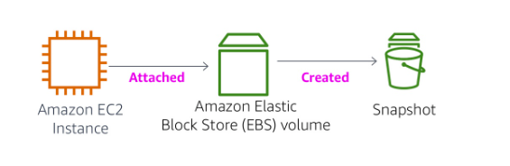
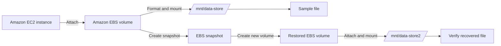
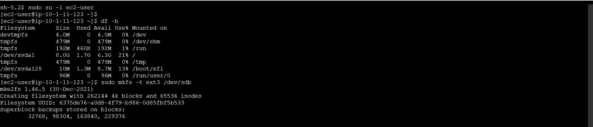
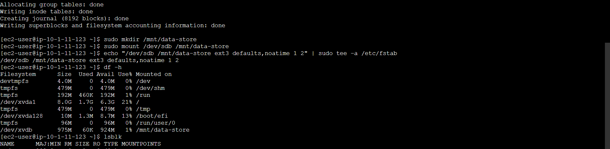
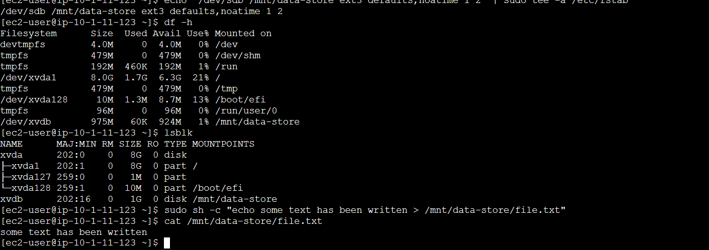
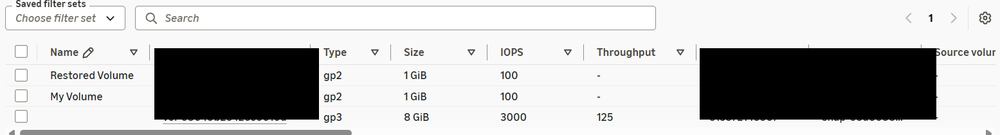
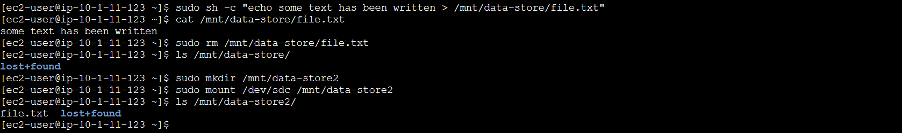

# EBS

A step-by-step walkthrough for adding an Amazon EBS volume to an EC2 instance, formatting and mounting it, creating a file, saving a snapshot, and restoring the file to a new volume. A short explanation appears before every command and screenshot.

## Project summary

| Item | Value used in the lab |
| --- | --- |
| Compute | Linux instance on Amazon EC2 |
| Data volume | EBS `gp2`, 1 GiB |
| Filesystem | `ext3` |
| Original mount point | `/mnt/data-store` |
| Restored mount point | `/mnt/data-store2` |

## Snapshot and recovery flow

The diagram summarizes the relationship between an instance, its EBS volume, and a snapshot.





## Step-by-step

### 1. Create and attach the data volume

In the EC2 console, create a 1 GiB `gp2` EBS volume in the same Availability Zone as the EC2 instance. Attach it to the instance using the device name shown by the lab. Linux device names can differ from the names shown in the console.

### 2. Confirm the device and format it

Connect to the instance and inspect available filesystems and devices.

This command displays mounted filesystem space so you can compare before and after attaching the new volume.

```bash
df -h
```

This command creates an `ext3` filesystem on the attached device. Formatting erases existing data, so verify the device name before running it.

```bash
sudo mkfs -t ext3 /dev/sdb
```

The screenshot shows the filesystem creation output from the lab terminal.



### 3. Mount the new volume

This command creates a directory that will serve as the mount point.

```bash
sudo mkdir -p /mnt/data-store
```

This command mounts the formatted device at `/mnt/data-store` for the current session.

```bash
sudo mount /dev/sdb /mnt/data-store
```

This command appends a mount entry to `/etc/fstab` so Linux attempts to mount the volume during boot. The lab uses a device path for practice; a filesystem UUID is more stable for real systems.

```bash
echo "/dev/sdb /mnt/data-store ext3 defaults,noatime 1 2" | sudo tee -a /etc/fstab
```

This command shows the filesystem table so you can confirm the new mount is present.

```bash
cat /etc/fstab
```

This command confirms that the mounted volume appears in the filesystem usage list.

```bash
df -h
```

The terminal capture shows the mount entry and the new filesystem in the command output.



### 4. Write and verify a sample file

This command writes a small text file to the mounted EBS volume.

```bash
sudo sh -c 'echo "some text has been written" > /mnt/data-store/file.txt'
```

This command prints the file contents so you can verify the write succeeded.

```bash
cat /mnt/data-store/file.txt
```

This command lists block devices and mount points to verify which device backs `/mnt/data-store`.

```bash
lsblk
```

The screenshot shows the file contents and storage device verification from the terminal.



### 5. Create the EBS snapshot

In the EC2 console, select the data volume and choose **Create snapshot**. Add a descriptive name such as `My Snapshot`, then wait for the snapshot status to become **Completed** before using it for recovery.

The screenshot records the snapshot entry in the console. Resource identifiers are concealed.


The volume list helps distinguish the original data volume from the root disk. Identifiers and owner information are hidden.


### 6. Delete the original file to simulate data loss

This command removes the sample file from the original mounted volume. Run it only after the snapshot is complete.

```bash
sudo rm /mnt/data-store/file.txt
```

This command lists the original mount point so you can confirm the file is no longer there.

```bash
ls -l /mnt/data-store/
```

### 7. Create and attach a volume from the snapshot

In **Snapshots**, select the completed snapshot and choose **Create volume from snapshot**. Select the same Availability Zone as the EC2 instance. Then, in **Volumes**, select the new restored volume and attach it to the instance using the next available device name (the lab uses `/dev/sdc`).

The screenshot shows the restored volume alongside the original volume. AWS resource identifiers are concealed.



### 8. Mount the restored volume and verify recovery

This command creates a separate mount point for the restored volume.

```bash
sudo mkdir -p /mnt/data-store2
```

This command mounts the restored device at `/mnt/data-store2`. Confirm the actual device name in your instance before running it.

```bash
sudo mount /dev/sdc /mnt/data-store2
```

This command lists the restored filesystem contents. The original `file.txt` should be present.

```bash
ls -l /mnt/data-store2/
```

This command prints the recovered file so you can compare its contents with the original.

```bash
cat /mnt/data-store2/file.txt
```

The terminal evidence shows the deleted original file and the recovered file on the restored volume.



## Result

The project created an EBS snapshot, removed a test file from the original volume, created a new volume from the snapshot, and verified that the file was recoverable from the restored volume.

## Key takeaways

- An EBS volume is separate from the EC2 instance and can be attached independently.
- A volume and its attached instance must be in the same Availability Zone.
- Creating a volume in AWS, formatting it, and mounting it are separate steps.
- A snapshot is useful only when the restore procedure is understood and verified.
- Confirm the device name before formatting or mounting a disk.

## Operational notes

- `mkfs` can destroy data on the selected device.
- Prefer filesystem UUIDs in `/etc/fstab` for stable mounts.
- Snapshots and volumes can incur charges; clean up training resources when finished.

## AWS documentation

- [Create and attach an EBS volume](https://docs.aws.amazon.com/AWSEC2/latest/UserGuide/ebs-creating-volume.html)
- [Create Amazon EBS snapshots](https://docs.aws.amazon.com/AWSEC2/latest/UserGuide/EBSSnapshots.html)
- [Extend a Linux filesystem after resizing a volume](https://docs.aws.amazon.com/AWSEC2/latest/UserGuide/recognize-expanded-volume-linux.html)
