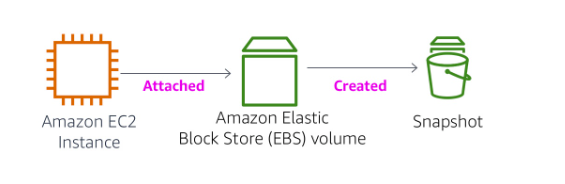
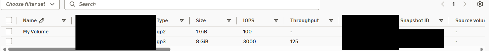
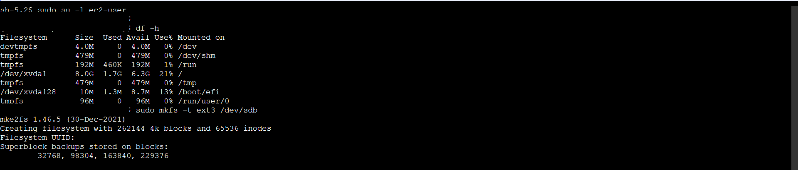
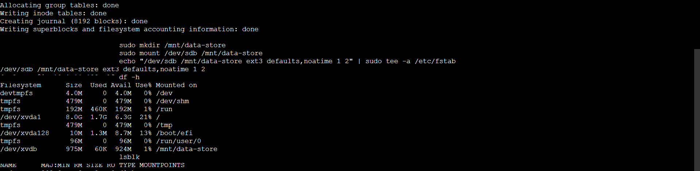
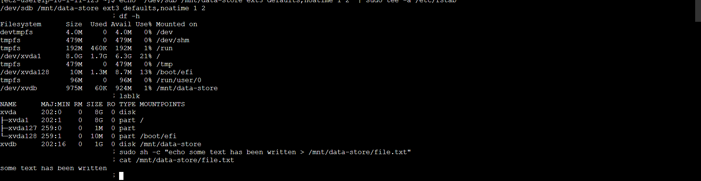
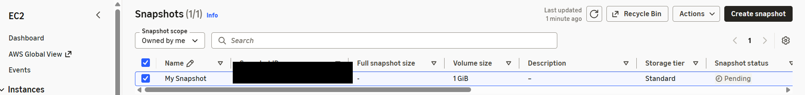
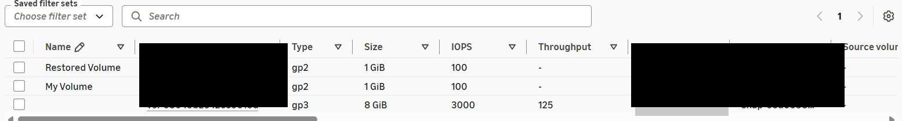

# EBS

A step-by-step guide to creating an Amazon EBS volume, attaching it to EC2, formatting and mounting a filesystem, saving a snapshot, and recovering a deleted file on a restored volume. Each command and screenshot has a short explanation immediately before it.

## Objectives

- Create and attach a 1 GiB EBS volume.
- Format it as `ext3` and mount it on a Linux EC2 instance.
- Write and verify a test file.
- Create a snapshot and restore the test file to a new volume.

## Architecture

This illustration shows the relationship between an EC2 instance, its EBS volume, and a snapshot.



## Configuration summary

| Item | Lab value |
| --- | --- |
| EC2 instance | `Lab`, in the same Availability Zone as the volumes |
| Original volume | `My Volume`, `gp2`, 1 GiB, device `/dev/sdb` |
| Filesystem | `ext3`, mounted at `/mnt/data-store` |
| Snapshot | `My Snapshot` |
| Restored volume | `Restored Volume`, device `/dev/sdc` |
| Restored mount point | `/mnt/data-store2` |
| Annotated command list | [`commands.sh`](./commands.sh) |

The existing 8 GiB root volume makes the new 1 GiB data volumes easy to identify. Device names can differ between EC2 console settings and Linux; verify the actual device before using it.

## Step-by-step walkthrough

### 1. Create the data volume

1. In **EC2 → Instances**, note the Availability Zone of the `Lab` instance.
2. Open **Volumes** and confirm the existing 8 GiB root volume.
3. Choose **Create volume**. Select **General Purpose SSD (`gp2`)**, size `1` GiB, and the same Availability Zone as the instance.
4. Add the tag `Name = My Volume` and create the volume.
5. Refresh until the volume state is **Available**.

This console screenshot shows `My Volume` and the larger root volume before the restore step. AWS IDs and account identifiers are concealed.



### 2. Attach the volume and connect to EC2

1. Select **My Volume** and choose **Actions → Attach volume**.
2. Select the `Lab` instance and device name `/dev/sdb`, then choose **Attach volume**. Wait for **In-use**.
3. Select the EC2 instance and choose **Connect → Session Manager → Connect**.

This command switches the shell to the `ec2-user` account used for the lab commands.

```bash
sudo su -l ec2-user
```

### 3. Check the disk and create a filesystem

This command shows currently mounted filesystem sizes so you can compare before and after adding the volume.

```bash
df -h
```

This command creates an `ext3` filesystem on `/dev/sdb`. Formatting can erase existing data, so confirm the device name first.

```bash
sudo mkfs -t ext3 /dev/sdb
```

The screenshot shows the initial disk usage and the filesystem creation output. Internal shell prompts and the filesystem UUID are concealed.



### 4. Mount the volume and make the mount persistent

This command creates the directory that will act as the data volume's mount point.

```bash
sudo mkdir /mnt/data-store
```

This command mounts `/dev/sdb` at `/mnt/data-store` for the current session.

```bash
sudo mount /dev/sdb /mnt/data-store
```

This command appends a mount entry to `/etc/fstab` so the system attempts to mount the volume during boot. The lab uses a device path; UUIDs are more stable for real systems.

```bash
echo "/dev/sdb /mnt/data-store ext3 defaults,noatime 1 2" | sudo tee -a /etc/fstab
```

This command prints the filesystem table so you can confirm the new entry.

```bash
cat /etc/fstab
```

This command confirms the new filesystem appears in the mounted-space report.

```bash
df -h
```

This command displays the block-device tree and mount points.

```bash
lsblk
```

The terminal screenshot shows the mount entry and filesystem checks.



### 5. Write and verify a test file

This command writes sample text to `file.txt` on the mounted EBS volume.

```bash
sudo sh -c "echo some text has been written > /mnt/data-store/file.txt"
```

This command reads the file so you can verify the saved contents.

```bash
cat /mnt/data-store/file.txt
```

The terminal screenshot shows the `lsblk` output and the test file verification.



### 6. Create the EBS snapshot

1. Open **Volumes**, select **My Volume**, and choose **Actions → Create snapshot**.
2. Add the tag `Name = My Snapshot` and create the snapshot.
3. Open **Snapshots** and wait for the status to change from **Pending** to **Completed** before restoring from it.

This console capture shows the snapshot while its status is pending. Its unique ID is concealed.



### 7. Simulate data loss on the original volume

Run this command only after the snapshot has completed. It deletes the test file from the original volume.

```bash
sudo rm /mnt/data-store/file.txt
```

This command lists the original mount point so you can confirm the test file is gone.

```bash
ls /mnt/data-store/
```

Only `lost+found` should remain in the lab filesystem.

### 8. Create and attach a volume from the snapshot

1. In **Snapshots**, select **My Snapshot** and choose **Actions → Create volume from snapshot**.
2. Choose the same Availability Zone as the EC2 instance. Add `Name = Restored Volume` and create the volume.
3. In **Volumes**, select **Restored Volume** and choose **Actions → Attach volume**.
4. Select the `Lab` instance and device name `/dev/sdc`, then attach it. Wait for **In-use**.

The volume list shows the restored volume alongside the original and root volumes. IDs and owner information are concealed.



### 9. Mount the restored volume and verify the file

This command creates a separate mount point for the restored data volume.

```bash
sudo mkdir /mnt/data-store2
```

This command mounts the restored device at `/mnt/data-store2`. Confirm the Linux device name before running it.

```bash
sudo mount /dev/sdc /mnt/data-store2
```

This command lists the restored directory and checks that the original file exists.

```bash
ls /mnt/data-store2/
```

This command prints the recovered file's contents.

```bash
cat /mnt/data-store2/file.txt
```

The terminal capture shows the removed original file and the recovered copy on the restored volume.


## Results

The test file was deleted from the original volume and then recovered from a volume created from the snapshot. This confirmed the snapshot restore workflow.

## What I learned

- EBS volumes are scoped to an Availability Zone and must be in the same Zone as the EC2 instance to attach.
- A new volume needs a filesystem and mount point before use.
- `/etc/fstab` can persist a mount across reboots.
- A snapshot can create a new volume for recovery.
- Linux device names can differ from the EC2 console's requested attachment name.

## Cleanup

The AWS Academy sandbox removes resources when the lab ends. In a personal account, delete unused volumes and snapshots to avoid ongoing storage charges.

## AWS references

- [Amazon EBS](https://aws.amazon.com/ebs/)
- [Amazon EBS documentation](https://docs.aws.amazon.com/ebs/)
