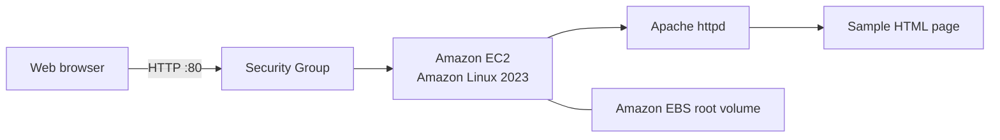
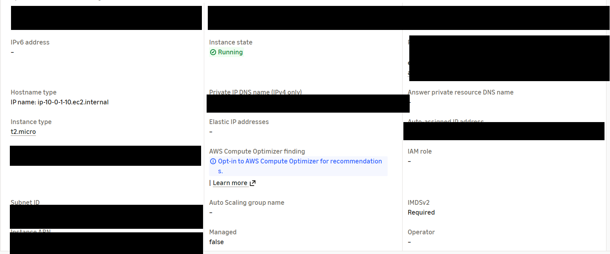
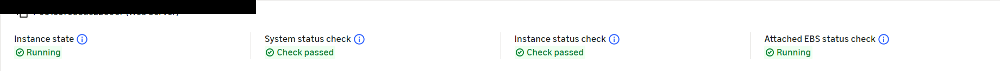
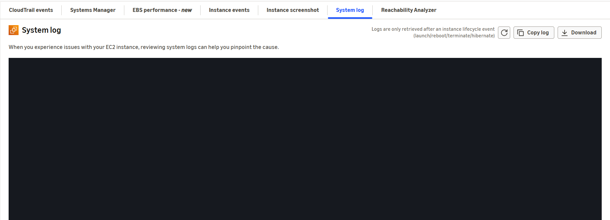

# EC2

A step-by-step walkthrough for launching an Amazon Linux 2023 instance, installing Apache with EC2 User Data, opening HTTP access, checking instance health, and confirming the web page loads.

## Project summary

| Item | Value used in the lab |
| --- | --- |
| Compute | Amazon EC2, `t2.micro` initially |
| Operating system | Amazon Linux 2023 |
| Web server | Apache HTTP Server (`httpd`) |
| Network | Lab VPC and public subnet |
| Inbound web traffic | HTTP, TCP port `80` |
| Storage | EBS root volume; lab later increases it from 8 GiB to 10 GiB |

## How the request reaches the page



## Step-by-step

### 1. Launch and name the EC2 instance

Open the EC2 launch workflow, name the instance `Web Server`, select the Amazon Linux 2023 AMI, and choose the lab instance type. The screenshot shows the resulting instance list; unique instance identifiers are hidden.


Choose the lab VPC and a public subnet. Create a security group for this server and add an inbound rule for HTTP on TCP port `80`. Keep the default EBS root disk for the initial launch.


### 2. Automate Apache installation with User Data

In **Advanced details**, enable termination protection for the lab exercise and paste the commands below into **User data**. User Data runs during the instance's first boot.

This command selects Bash to run the startup script.

```bash
#!/bin/bash
```

This command installs Apache and its service package.

```bash
dnf install -y httpd
```

This command configures Apache to start automatically after future reboots.

```bash
systemctl enable httpd
```

This command starts Apache immediately on this first boot.

```bash
systemctl start httpd
```

This command writes a simple HTML page into Apache's default web directory.

```bash
echo '<html><h1>Hello From Your Web Server!</h1></html>' > /var/www/html/index.html
```

Launch the instance and wait until the instance state is **Running** and the status checks pass. The summary screenshot shows the instance configuration; sensitive network and AWS identifiers are concealed.



### 3. Check instance health and startup diagnostics

Open the instance health/status checks and confirm both the system and instance checks pass before troubleshooting the website.



The lab also demonstrates opening the system log. This capture shows an empty log panel, so it does not provide startup output; use instance status checks and application access as the verification evidence.



### 4. Open the website over HTTP

In the EC2 console, copy the instance's current public IPv4 address and open it in a browser. The security group must allow inbound TCP port `80`. Do not publish the address from a temporary lab instance.

The page below confirms that Apache returned the sample HTML page over HTTP.


### 5. Resize and protect the instance (lab extension)

The lab continues by stopping the instance, changing its type from `t2.micro` to `t2.small`, and increasing the root EBS volume from 8 GiB to 10 GiB. Start the instance again and verify it returns to **Running**.

Stop protection is also tested as a safeguard against an accidental stop. Termination protection and stop protection are separate settings; review each setting before changing a lab instance.

## Result

- The instance launched and reached **Running** with passing status checks.
- Apache was installed automatically using User Data.
- A security group rule allowed HTTP access on port `80`.
- The browser displayed the sample page.
- The lab covered compute and root-volume resizing and instance protection settings.

## Key takeaways

- Use EC2 User Data to automate repeatable first-boot configuration.
- A security group controls inbound traffic to the instance.
- Verify status checks before debugging application connectivity.
- A public IPv4 address may change after a stop/start unless an Elastic IP is used.
- Never place credentials or private keys in User Data or a public repository.

## AWS documentation

- [Launch an EC2 instance](https://docs.aws.amazon.com/AWSEC2/latest/UserGuide/LaunchingAndUsingInstances.html)
- [Run commands on a Linux instance at launch](https://docs.aws.amazon.com/AWSEC2/latest/UserGuide/user-data.html)
- [Control traffic with security groups](https://docs.aws.amazon.com/AWSEC2/latest/UserGuide/using-network-security.html)
- [Change an instance type](https://docs.aws.amazon.com/AWSEC2/latest/UserGuide/ec2-instance-resize.html)
