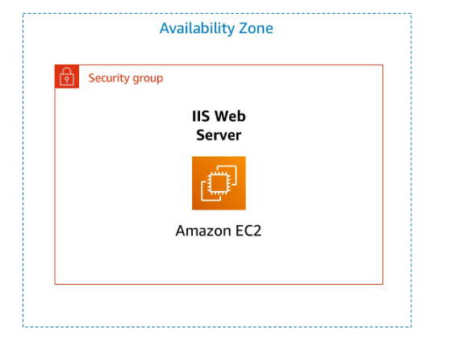
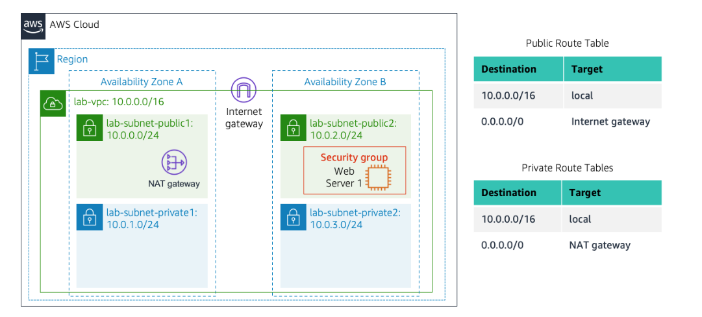
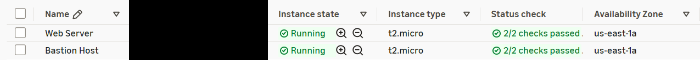
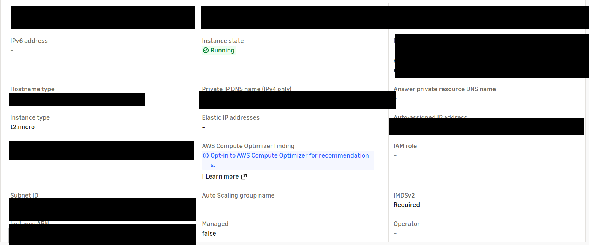
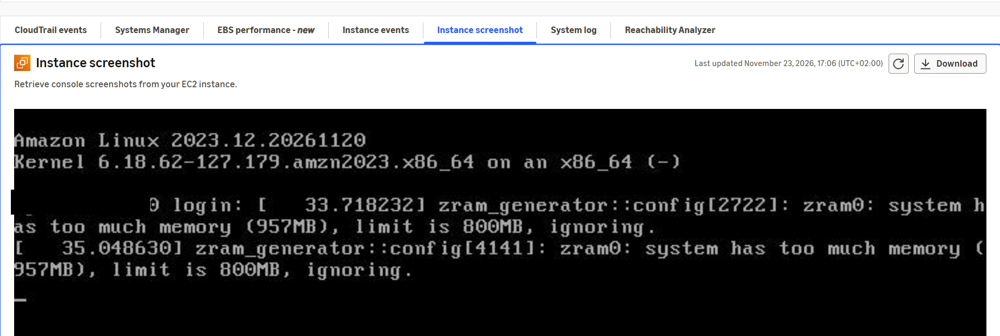
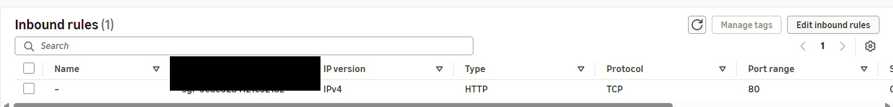

# EC2

A step-by-step guide to launching an Amazon Linux 2023 web server, checking its health, opening HTTP access, resizing it, and testing instance protection. The lab uses Apache (`httpd`) and a sample HTML page.

## Objectives

- Launch an EC2 instance with termination protection.
- Monitor status checks, CloudWatch metrics, the system log, and the console screenshot.
- Allow HTTP access through a Security Group.
- Change the instance type and EBS root volume size.
- Explore EC2 service quotas and test stop protection.

## Architecture

The first illustration shows an EC2 web server inside a Security Group in an Availability Zone. It is a reference architecture for the compute and firewall concepts in this lab.



This second illustration adds the VPC, public and private subnets, route tables, an Internet Gateway, and a NAT Gateway as networking context.



## Configuration summary

| Setting | Lab value |
| --- | --- |
| Region | N. Virginia (`us-east-1`) |
| Name tag | `Web Server` |
| AMI | Amazon Linux 2023 |
| Instance type | `t2.micro`, later changed to `t2.small` |
| Key pair | `vockey` |
| Network | `Lab VPC`, `PublicSubnet1` |
| Security Group | `Web Server security group` |
| Root EBS volume | 8 GiB, later changed to 10 GiB |
| Protections | Termination protection at launch; stop protection enabled later |
| Startup script | [`user-data.sh`](./user-data.sh) |

## Step-by-step walkthrough

### 1. Launch and configure the EC2 instance

1. Open **Services → EC2** and confirm the region is **N. Virginia (`us-east-1`)**.
2. Choose **Launch instance → Launch instance**.
3. Set the instance name to `Web Server`.
4. Keep the **Amazon Linux 2023 AMI** selected.
5. Keep the `t2.micro` instance type.
6. Select the lab key pair named `vockey`.
7. Under **Network settings**, choose **Edit** and select `Lab VPC` and `PublicSubnet1`.
8. Create a Security Group named `Web Server security group`. Remove the default inbound rule so no inbound traffic is allowed yet.
9. Keep the default 8 GiB root volume.
10. Under **Advanced details**, enable **Termination protection** and add the User Data script in the next section.
11. Choose **Launch instance → View all instances**. Wait for **Running** and **2/2 status checks passed**.

The instance list confirms that the server launched and its status checks passed. Unique instance identifiers are concealed.



The instance summary shows its selected type and running state. Address and AWS resource identifiers are hidden.



### 2. Install Apache with User Data

Paste the commands below into the instance's **User data** field. User Data runs as a startup script on the instance's first boot. The full annotated script is available in [`user-data.sh`](./user-data.sh).

This line selects Bash as the interpreter for the startup script.

```bash
#!/bin/bash
```

This command installs the Apache HTTP server package.

```bash
dnf install -y httpd
```

This command enables Apache to start automatically after reboots.

```bash
systemctl enable httpd
```

This command starts Apache immediately on the first boot.

```bash
systemctl start httpd
```

This command writes the sample page to Apache's default document root.

```bash
echo '<html><h1>Hello From Your Web Server!</h1></html>' > /var/www/html/index.html
```

### 3. Check instance health and startup diagnostics

1. Select the instance and open **Status checks**. Confirm both system and instance reachability pass.
2. Open **Monitoring** to review CloudWatch metrics. Basic monitoring uses a five-minute interval; detailed monitoring uses a one-minute interval.
3. Choose **Actions → Monitor and troubleshoot → Get system log**. The screenshot below shows the system log panel as captured in the lab.
4. Choose **Actions → Monitor and troubleshoot → Get instance screenshot** to view the instance's console output.

The system log panel is shown here as diagnostic evidence from the lab.


This console screenshot shows Amazon Linux boot output from the instance.



### 4. Allow HTTP and open the web page

1. Open the instance's **Details** tab and copy its current public IPv4 address. Do not publish a temporary lab address.
2. Open that address in a browser. The page initially does not load because the Security Group has no inbound HTTP rule.
3. Return to EC2, open **Security Groups**, and select `Web Server security group`.
4. Under **Inbound rules**, choose **Edit inbound rules → Add rule**. Set **Type** to **HTTP** and **Source** to **Anywhere-IPv4 (`0.0.0.0/0`)**, then save.
5. Refresh the browser tab.

The Security Group screenshot shows the inbound HTTP rule on TCP port 80. Resource identifiers are concealed.



This browser capture confirms that Apache returned the sample page. Its browser address bar and public IP have been removed.


### 5. Resize the instance and its root volume

1. In **Instances**, select `Web Server`, choose **Instance state → Stop instance**, and wait for **Stopped**.
2. Choose **Actions → Instance settings → Change instance type**, select `t2.small`, and apply the change.
3. Choose **Actions → Instance settings → Change stop protection**, enable it, and save.
4. Open the **Storage** tab, select the root volume, and choose **Actions → Modify volume**.
5. Change the size from 8 GiB to 10 GiB and confirm the modification.
6. Return to **Instances** and start the instance.

After a stop/start, the instance may receive a different public IPv4 address. The private IP remains the same. Use an Elastic IP when a stable public address is required.

### 6. Explore EC2 service quotas

1. Search for **Service Quotas** in the AWS console.
2. Open **AWS services**, search for `ec2`, and select **Amazon Elastic Compute Cloud (Amazon EC2)**.
3. Search for `running on-demand` and review the regional quota values without changing them.

This step demonstrates that AWS accounts have per-region limits and that eligible quotas can be requested for increase.

### 7. Test stop protection

1. Select the instance and choose **Instance state → Stop instance**. Confirm that the stop is blocked while stop protection is enabled.
2. Open **Actions → Instance settings → Change stop protection**, disable the setting, and save.
3. Stop the instance again to confirm that it now succeeds.

## Results

- The instance launched in the lab VPC and passed its EC2 status checks.
- User Data installed and started Apache automatically.
- A Security Group rule allowed HTTP traffic on port 80.
- The browser displayed the sample page.
- The lab covered instance type and EBS root volume resizing, service quotas, termination protection, and stop protection.

## What I learned

- A Security Group is a stateful virtual firewall; a new group has no inbound rules by default.
- User Data automates first-boot configuration.
- Status checks, CloudWatch, system logs, and console screenshots help diagnose instance problems.
- The instance must be stopped before changing its type.
- Termination protection and stop protection are separate safeguards.

## Cleanup

The AWS Academy sandbox removes its resources when the lab ends. In a personal account, review costs and delete temporary resources when finished. Disable termination protection before terminating an instance.

## AWS references

- [Launch an EC2 instance](https://docs.aws.amazon.com/AWSEC2/latest/UserGuide/LaunchingAndUsingInstances.html)
- [User Data and shell scripts](https://docs.aws.amazon.com/AWSEC2/latest/UserGuide/user-data.html)
- [Security Groups](https://docs.aws.amazon.com/AWSEC2/latest/UserGuide/using-network-security.html)
- [Status checks](https://docs.aws.amazon.com/AWSEC2/latest/UserGuide/monitoring-system-instance-status-check.html)
- [Change an instance type](https://docs.aws.amazon.com/AWSEC2/latest/UserGuide/ec2-instance-resize.html)
- [EC2 service quotas](https://docs.aws.amazon.com/AWSEC2/latest/UserGuide/ec2-resource-limits.html)
