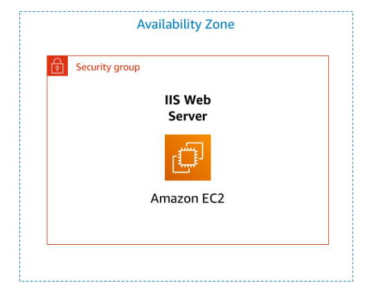
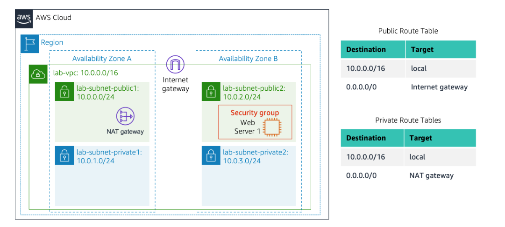

# AWS Cloud Portfolio

A collection of hands-on projects documenting practical work with AWS compute, networking, and storage. Each project has its own step-by-step guide, command explanations, and labeled screenshots.

## Projects

| Project | What it covers | Main AWS services |
| --- | --- | --- |
| [EC2](./EC2/README.md) | Launch an Amazon Linux instance, install Apache with User Data, allow HTTP, check health, and verify the site | Amazon EC2, Amazon EBS, Security Groups |
| [EBS](./EBS/README.md) | Create and mount an EBS volume, write a test file, create a snapshot, and recover that file on a restored volume | Amazon EBS, Amazon EC2 |

## Repository layout

```text
Cloud/
├── README.md
├── assets/                         # Supplementary reference diagrams
├── EC2/                             # EC2 walkthrough and evidence
└── EBS/                             # EBS walkthrough and evidence
```

## Reference architecture diagrams

These diagrams provide extra context for AWS networking and EC2 concepts. They are supporting references and are not presented as deployed architecture for the two lab projects above.

The first diagram illustrates an EC2 web server protected by a security group inside an Availability Zone.



The second diagram illustrates a VPC with public and private subnets, route tables, an Internet Gateway, and a NAT Gateway.



## Notes

- Project folders separate instructions, evidence, and project specific details.
- Screenshots were prepared for a public portfolio; account identifiers and resource IDs are masked or cropped.
- These are training projects. Review AWS costs and remove temporary resources after completing a lab.
- Never commit credentials, private keys, account identifiers, or personal contact details.
