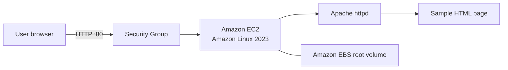

# Hosting a Web Server with Amazon EC2

A hands-on project covering how to launch a Linux instance on EC2, install Apache automatically at startup, serve a page over HTTP, monitor the instance, and adjust its resources.

## Overview

| Component | Configuration |
| --- | --- |
| Operating system | Amazon Linux 2023 |
| Compute | EC2, initially `t2.micro` |
| Web server | Apache HTTP Server (`httpd`) |
| Networking | Lab VPC, public subnet, and a dedicated security group |
| Application access | HTTP on port `80` |
| Storage | EBS root volume, increased from 8 to 10 GiB during the lab |

## Architecture



The security group allows HTTP requests to reach the instance. Apache serves a static HTML page from the web root. The instance was placed in the lab's public network so the page could be opened from a browser.

## What I implemented

1. Launched an EC2 instance in the lab network and enabled termination protection.
2. Used User Data to install Apache and enable the service at startup.
3. Updated the security group to allow inbound HTTP traffic on port 80.
4. Verified the instance state and status checks, then opened the web page in a browser.
5. Monitored the instance, changed its type from `t2.micro` to `t2.small`, and expanded its root volume from 8 to 10 GiB.
6. Enabled stop protection and observed how it prevents accidental stops.

## Automated setup

This is a simplified example of the User Data script used in the exercise:

```bash
#!/bin/bash
dnf install -y httpd
systemctl enable httpd
systemctl start httpd
echo '<html><h1>Hello From Your Web Server!</h1></html>' > /var/www/html/index.html
```

## Verification and result

- The EC2 instance reached the `Running` state and passed its status checks.
- The welcome page loaded in a browser through the instance's public address.
- The lab included security protection checks and changes to the instance and volume size.


*The browser frame and IP address have been removed from this screenshot.*

## Key takeaways

- Use User Data to automate first-boot setup instead of installing software manually.
- Use security groups to control network access to an instance.
- Understand the difference between stopping and terminating an instance, and use safeguards to prevent accidental actions.
- Check instance health before troubleshooting application reachability.
- Adjust the instance type or EBS volume size as workload needs change.

## Security and operations

- A public HTTP rule is suitable only for a short demonstration. For a real application, limit the source addresses and configure HTTPS.
- Never place passwords, private keys, or credentials in User Data or GitHub.
- An instance's public IPv4 address can change after it is stopped and started.
- Lab resources are temporary. Stop or delete them after the exercise to avoid unexpected charges.

## AWS references

- [Launch an EC2 instance](https://docs.aws.amazon.com/AWSEC2/latest/UserGuide/LaunchingAndUsingInstances.html)
- [Run commands on your Linux instance at launch](https://docs.aws.amazon.com/AWSEC2/latest/UserGuide/user-data.html)
- [Control traffic with security groups](https://docs.aws.amazon.com/AWSEC2/latest/UserGuide/using-network-security.html)
- [Change the instance type](https://docs.aws.amazon.com/AWSEC2/latest/UserGuide/ec2-instance-resize.html)
