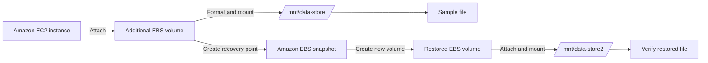
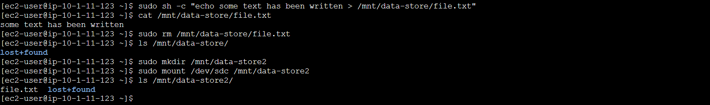

# Amazon EBS Storage, Snapshots, and Restore

A hands-on project demonstrating the lifecycle of an additional EBS volume: create it, attach it to a Linux EC2 instance, format and mount a filesystem, create a snapshot, and restore data to a new volume.

## Overview

| Component | Configuration |
| --- | --- |
| Compute | Linux instance on Amazon EC2 |
| Additional volume | Amazon EBS, `gp2`, 1 GiB |
| Filesystem | `ext3` |
| Mount point | `/mnt/data-store` |
| Backup and restore | EBS snapshot restored to a new volume mounted at `/mnt/data-store2` |

## Data flow



## Workflow

1. Created a 1 GiB EBS volume in the same Availability Zone as the instance.
2. Attached the volume to the instance using a device name provided by the lab.
3. Created an `ext3` filesystem and mounted the volume at `/mnt/data-store`.
4. Created a sample file and verified its contents.
5. Created a snapshot, then deleted the file from the mounted original volume.
6. Created a new volume from the snapshot, attached it, and mounted it at `/mnt/data-store2`.
7. Verified that the file was available from the restored volume.

## Linux commands

> Device names such as `/dev/sdb` and `/dev/sdc` are specific to the lab and can differ between systems.

```bash
sudo mkfs -t ext3 /dev/sdb
sudo mkdir -p /mnt/data-store
sudo mount /dev/sdb /mnt/data-store
df -h
```

Write a sample file and verify it:

```bash
sudo sh -c 'echo "some text has been written" > /mnt/data-store/file.txt'
cat /mnt/data-store/file.txt
```

After creating and attaching the restored volume:

```bash
sudo mkdir -p /mnt/data-store2
sudo mount /dev/sdc /mnt/data-store2
ls -l /mnt/data-store2/
```

## Verification and result

The additional filesystem appeared in `df -h`. After the original file was deleted, it was present on the volume created from the snapshot, confirming that the restore workflow succeeded.



*Terminal screenshot from the lab exercise. The internal host name is retained in the original capture.*

## Key takeaways

- An EBS volume is separate from an EC2 instance and can be attached or detached when service constraints allow.
- The volume and instance must be in the same Availability Zone to attach the volume.
- Formatting a filesystem and mounting it are separate from creating the EBS volume in AWS.
- A snapshot can be used to create a new volume and recover files from an earlier point in time.
- `df -h`, `lsblk`, and basic file commands help verify storage and mount state.

## Operational considerations

- `mkfs` formats a device and can erase existing data. Confirm the device name before running it.
- For persistent mounts, use a stable identifier such as a UUID instead of relying on a device name that can change. The lab example added `/dev/sdb` to `/etc/fstab` for practice.
- A snapshot is not a substitute for a restore test. Periodically verify that backed-up files can be recovered.
- Review volume and snapshot costs, and clean up temporary resources after training.

## AWS references

- [Create and attach an EBS volume](https://docs.aws.amazon.com/AWSEC2/latest/UserGuide/ebs-creating-volume.html)
- [Create Amazon EBS snapshots](https://docs.aws.amazon.com/AWSEC2/latest/UserGuide/EBSSnapshots.html)
- [Extend a Linux file system after resizing a volume](https://docs.aws.amazon.com/AWSEC2/latest/UserGuide/recognize-expanded-volume-linux.html)
